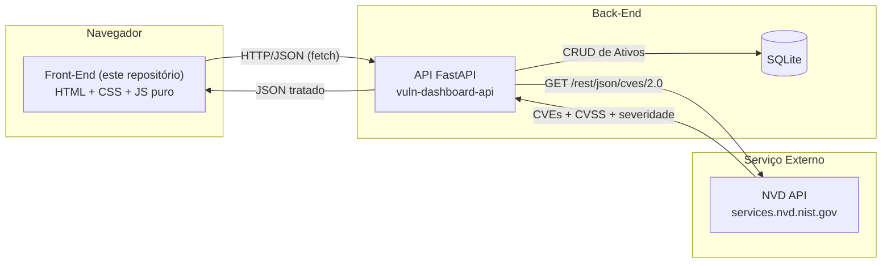

# Painel de Vulnerabilidades por Software — Interface (Front-End)

Interface web (HTML/CSS/JS puro, sem frameworks) para cadastrar ativos
(softwares/versões) e visualizar as vulnerabilidades conhecidas (CVEs)
relacionadas a eles, consultadas via NVD API através da API back-end.

Este repositório implementa a camada **Interface (Front-End)** do MVP: Interface (Front-End) + API (Back-End) + API Externa.

> Repositório irmão: [`vuln-dashboard-api`](../vuln-dashboard-api) — a API que
> este front-end consome. **A interface nunca chama a NVD diretamente.**

## Sumário

- [Arquitetura](#arquitetura)
- [Funcionalidades](#funcionalidades)
- [A API externa: NVD](#a-api-externa-nvd)
- [Estrutura de pastas](#estrutura-de-pastas)
- [Instalação e execução local](#instalação-e-execução-local)
- [Execução via Docker](#execução-via-docker)
- [Subindo tudo junto com docker-compose](#subindo-tudo-junto-com-docker-compose)
- [Configuração da URL da API](#configuração-da-url-da-api)

## Arquitetura



Toda chamada HTTP feita pelo JavaScript desta interface vai para a **API
back-end** (`assets/js/api.js`). A NVD nunca é chamada a partir do navegador —
isso evita expor eventuais chaves de API e centraliza tratamento de erros,
cache e regras de negócio no back-end.

## Funcionalidades

- Listagem de ativos cadastrados com:
  - Filtro por categoria
  - Paginação (itens por página configurável)
  - Ordenação por nome ou data de cadastro
- Formulário para cadastrar novo ativo
- Ações de editar e excluir por ativo, direto na tabela
- Ao clicar em um ativo (ou no botão "CVEs"), exibe:
  - Um resumo visual (mini gráfico de barras) de CVEs por severidade
  - A lista de CVEs relacionados, cada um com um badge colorido por
    severidade: 🔴 `CRITICAL`, 🟠 `HIGH`, 🟡 `MEDIUM`, 🟢 `LOW`
- Tratamento de estados de erro da API (timeout, rate limit, sem resultados,
  falha de conexão)
- Configuração opcional de uma **API Key** (botão "Chave de API" no topo),
  usada apenas se o back-end exigir autenticação nas rotas de escrita

## A API externa: NVD

Este MVP consome a **NVD (National Vulnerability Database)**, mantida pelo
**NIST** (órgão do governo dos EUA), como serviço externo — o terceiro módulo
da arquitetura, junto com esta interface e a API back-end.

- **Documentação oficial**: https://nvd.nist.gov/developers/vulnerabilities
- **Endpoint consumido**: `GET https://services.nvd.nist.gov/rest/json/cves/2.0`
  — chamado exclusivamente pela API back-end, nunca por este front-end
- **Parâmetro usado**: `keywordSearch`, montado a partir do nome + versão do
  ativo cadastrado (ex.: `"nginx 1.18"`)
- **Licença de uso**: é um serviço público e gratuito do NIST; os dados de
  CVE retornados são de domínio público. O serviço impõe apenas um **limite
  de requisições** (rate limit), sem custo de uso.
- **Cadastro / chave de API**: **não é obrigatório**. Sem chave, o limite é
  de ~5 requisições a cada 30 segundos; com uma chave gratuita (solicitada em
  https://nvd.nist.gov/developers/request-an-api-key), o limite sobe para
  ~50 requisições a cada 30 segundos. A chave, quando usada, fica configurada
  apenas no back-end (variável `NVD_API_KEY`) e nunca trafega até o navegador.
- **Tratamento dos dados**: a API back-end nunca redireciona o usuário para a
  NVD — ela consome a resposta, extrai e trata os campos relevantes (ID do
  CVE, descrição, score CVSS, severidade e data de publicação) e devolve um
  JSON já pronto para esta interface exibir. Veja o detalhamento completo do
  parsing no README de [`vuln-dashboard-api`](../vuln-dashboard-api).

## Estrutura de pastas

```
vuln-dashboard-front/
├── index.html
├── assets/
│   ├── css/
│   │   └── style.css       # estilos do dashboard
│   └── js/
│       ├── env.js          # URL da API (dev); regerado em runtime no Docker
│       ├── api.js          # camada de acesso à API back-end
│       └── app.js          # estado da UI, renderização e eventos
├── docker/
│   ├── env.template.js     # template usado para gerar env.js no container
│   └── docker-entrypoint.sh
├── nginx.conf
├── Dockerfile
├── docker-compose.yml       # sobe front-end + back-end juntos (opcional)
├── .dockerignore
└── README.md
```

## Instalação e execução local

Não há build step nem dependências de Node — é HTML/CSS/JS puro. Basta servir
os arquivos estáticos. Duas opções simples:

```bash
cd vuln-dashboard-front

# Opção 1: servidor HTTP embutido do Python
python -m http.server 8080

# Opção 2: extensão "Live Server" do VS Code, ou qualquer servidor estático
```

Abra `http://localhost:8080` no navegador. Por padrão, `assets/js/env.js`
aponta para `http://localhost:8000` — garanta que a API back-end esteja
rodando nesse endereço (veja o README do `vuln-dashboard-api`).

## Execução via Docker

```bash
cd vuln-dashboard-front

docker build -t vuln-dashboard-front .

docker run -d \
  --name vuln-dashboard-front \
  -p 8080:80 \
  -e API_BASE_URL=http://localhost:8000 \
  vuln-dashboard-front
```

Acesse `http://localhost:8080`. A variável `API_BASE_URL` é injetada em
`assets/js/env.js` no momento em que o container sobe (veja
`docker/docker-entrypoint.sh`), então não é preciso rebuildar a imagem para
apontar para uma API diferente.

## Subindo tudo junto com docker-compose

Este repositório inclui um `docker-compose.yml` que sobe **front-end e
back-end juntos**, assumindo que os dois repositórios estão lado a lado na
mesma pasta pai:

```
projetos/
├── vuln-dashboard-api/
└── vuln-dashboard-front/   <- rode o comando abaixo a partir daqui
```

```bash
cd vuln-dashboard-front
docker compose up --build
```

- Front-end: http://localhost:8080
- API + Swagger: http://localhost:8000/docs

## Configuração da URL da API

| Ambiente          | Como configurar                                                                 |
|-------------------|----------------------------------------------------------------------------------|
| Local (sem Docker)| edite `assets/js/env.js` diretamente                                            |
| Docker (`docker run`) | variável de ambiente `API_BASE_URL` no `docker run`                        |
| docker-compose    | variável `API_BASE_URL` do serviço `front` em `docker-compose.yml`             |
